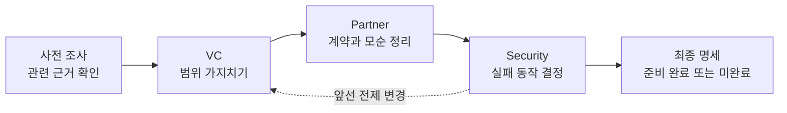

# We Need To Talk 🌶️

**“그냥 잘 되게 해줘.” 잠깐, 우리 이야기 좀 해요.**

[English](README.md) · [한국어](README.ko.md)


[](https://github.com/Malko-opensource/we-need-to-talk/actions/workflows/validate.yml)
[](LICENSE)

**We Need To Talk**는 **Codex와 Claude Code**에서 사용하는 요구사항 면담 스킬입니다. 세 가지 면담 관점으로 범위·아키텍처·실패 처리를 파고들고, 답변을 받을 때마다 결정을 파일로 남깁니다. 중요한 선택의 대가를 다르게 이해한 것 같으면 짧게 확인합니다. 마지막에는 구현 에이전트에게 넘길 수 있는 실행 명세를 만듭니다.

모티브는 그 한마디, **“오빠 나랑 이야기 좀 해.”** 사람을 괴롭히려는 건 아닙니다. 다만 “적당히 빠르고 확장성 있게”라는 문장은 무사히 넘어가지 못할 수 있습니다.

## 이런 대화가 됩니다

> **나:** “초안은 어디에도 저장하지 마. 그런데 앱이 죽어도 복원은 돼야 해.”
>
> **스킬:** “두 요구가 충돌해요. 복원할 초안은 어디에서 가져오죠?”
>
> **나:** “그럼 기기 안에만 저장하자. 서버 동기화는 빼고.”
>
> **스킬:** *결정을 파일에 기록합니다.* “저장 직전에 앱이 죽으면, 입력한 내용이 얼마나 사라져도 괜찮아요?”

이 대화는 설명용 예시입니다. 실제 면담에서는 여러분의 파일과 답변을 근거로 질문합니다.

## 무엇을 해주나요

- **근거를 들고 질문합니다.** 관련 코드·문서·앞선 결정부터 봅니다. 기존 프로젝트가 없으면 없다고 기록합니다.
- **매 답변을 기록합니다.** 결정, 가정, 열린 쟁점, 근거가 마크다운 파일에 남습니다.
- **선택의 대가를 보여줍니다.** 얻는 것과 포기할 것을 함께 설명하며, 비용 수치를 지어내지 않습니다.
- **결정을 바꿀 수 있습니다.** 이전 결정을 지우지 않고 새 결정과 변경 이력을 연결합니다.
- **미결정을 숨기지 않습니다.** 구현을 막는 쟁점이 남으면 `incomplete` 명세를 만듭니다.
- **중단하고 재개할 수 있습니다.** 긴 채팅의 기억 대신 저장된 파일에서 이어갑니다.
- **“내가 한 말 이해한 거 맞아?”** 중요한 선택에서 나온 “그냥 해줘”를 확정 결정으로 기록하기 전에 그 결과를 알고 있는지 확인합니다.

별도 서버·API 키·추가 서비스는 필요하지 않습니다. 파일을 읽고 쓸 수 있는 Codex 또는 Claude Code 환경은 있어야 합니다.

## 면담관을 고르세요

**지옥의 3자 대면, Tri-Grill Protocol**의 기본값은 `--mode gauntlet`입니다. **VC → Partner → Security** 순서로 한 에이전트가 관점을 바꾸며 같은 결정 기록을 이어갑니다.

| 모드 | 핵심 질문 | 정리할 내용 |
| --- | --- | --- |
| `vc` · Scope Guillotine | “그거 꼭 지금 다 만들어야 해요?” | 사용자 가치, 최소 범위, 제외 범위, 성공 기준 |
| `partner` · Consistency Grill | “기존 코드랑 말이 다르잖아요.” | 인터페이스, 상태 소유권, 계약, 모순 |
| `security` · Catastrophe Drill | “이러다 프로세스 죽으면 어쩔 건데요?” | 실패 동작, 신뢰 경계, 복구 책임 |
| `gauntlet` · 연속 콤보 | “범위부터 줄이고, 앞뒤를 맞추고, 실패를 따져보죠.” | 세 관점을 순서대로 검토 |

관문 하나에서 여러 번 문답할 수 있습니다. 기존 근거가 충분하면 같은 질문을 반복하지 않습니다. 뒤 단계에서 앞선 전제가 바뀌면 영향받은 관문만 다시 엽니다. 단일 모드에서는 검토한 범위와 다루지 않은 범위를 남깁니다.

`security`는 장애와 신뢰 경계를 묻는 설계 면담이며 보안 감사나 침투 테스트를 수행하지 않습니다. `vc`도 취미 프로젝트·내부 도구의 목적을 인정하며 수익화를 강요하지 않습니다.

```text
$we-need-to-talk 글쓰기 앱 --mode gauntlet --spiciness spicy
$we-need-to-talk MVP 범위부터 줄여줘 --mode vc
$we-need-to-talk 기존 상태 관리 설계의 모순을 찾아줘 --mode partner
$we-need-to-talk 재시도와 크래시 대응을 따져줘 --mode security --spiciness hell
```

## 매운맛을 고르세요

| 단계 | 면담 스타일 | 탐색 횟수 참고 |
| --- | --- | --- |
| 🌱 `mild` | 차분한 시니어가 큰 빈틈부터 확인 | 약 3~4회 |
| 🌶️ `spicy` | 비용과 실패 동작을 구체적으로 묻는 리드 | 약 5~7회 |
| 🔥 `hell` | 모든 가정에 반례를 들이대는 면담 | 약 8~12회 |

기본값은 `spicy`입니다. 횟수는 세 관문을 합한 **전체 면담 기준**의 권장 범위이며 채워야 할 할당량이 아닙니다. 어느 단계든 **한 번에 1~2개만** 묻습니다. 결정 변경, 보류, 강도 조절, 중단이 모두 가능합니다.

## “오빠, 내가 한 말 이해한 거 맞아?”

“추천대로 해줘”에는 알고 맡기는 경우도, 중요한 대가를 놓친 경우도 있습니다. **Readback Check**는 현재 결정과 앞선 답변을 보고 확인이 필요한지 판단합니다.

> **스킬:** “초안을 메모리에만 두면 간단하지만 재시작하면 사라져요.”
>
> **나:** “응, 그냥 그렇게 해줘.”
>
> **스킬:** “잠깐, 하나만 확인할게요. 저장 전에 앱이 꺼지면 초안은 어떻게 되는 걸로 이해했어요?”
>
> **나:** “없어지는 거지. v1은 그걸 감수할게.”
>
> **스킬:** *이해한 결과와 선택을 기록하고 다음으로 넘어갑니다.*

장난스러운 캐릭터로는 **“오빠, 내가 한 말 이해한 거 맞아?”**라고 시작할 수 있습니다. 핵심은 뒤에 붙는 구체적인 상황 질문입니다. “그래도 다시 켜면 살아나지?”라는 답이 나오면 합의로 처리하지 않고 이해가 엇갈린 쟁점으로 남깁니다.

중요한 선택의 결과가 불명확할 때만 확인합니다. 작은 구현 세부사항이나 이미 대가를 알고 맡긴 결정은 다시 묻지 않습니다. 설명을 요청하거나, 판단을 위임하거나, 확인 질문을 거절할 수 있습니다. 지식을 채점하거나 같은 승인을 반복해서 받는 절차가 아닙니다.

## 설치

### Codex — 스킬로 설치

Git과 Python 3.10 이상이 필요합니다.

```sh
git clone https://github.com/Malko-opensource/we-need-to-talk.git
cd we-need-to-talk
python3 scripts/install.py codex
```

설치 위치는 `${CODEX_HOME:-~/.codex}/skills/we-need-to-talk`입니다. 다른 내용의 기존 설치본을 자동으로 덮어쓰지 않습니다. 새 채팅에서 호출하세요.

```text
$we-need-to-talk 재시작해도 초안이 복원되는 메모 앱 --spiciness spicy
```

사용 중인 Codex가 `~/.agents/skills`를 검색한다면 위치를 지정할 수 있습니다.

```sh
python3 scripts/install.py codex --skills-dir "$HOME/.agents/skills"
```

한 위치에만 설치하세요. 현재 검색 경로는 [OpenAI 공식 스킬 문서](https://learn.chatgpt.com/docs/build-skills)를 참고하되, 설치된 로컬 버전에 따라 다를 수 있습니다.

### Claude Code — 플러그인으로 설치

Claude Code 안에서 마켓플레이스를 추가하고 설치합니다.

```text
/plugin marketplace add Malko-opensource/we-need-to-talk
/plugin install we-need-to-talk@we-need-to-talk
```

이후 다음처럼 호출합니다.

```text
/we-need-to-talk:we-need-to-talk 메모 앱 요구사항 --spiciness spicy
```

로컬 소스를 바로 불러올 수도 있습니다.

```sh
claude --plugin-dir ./plugins/we-need-to-talk
```

독립 스킬을 선호하면 `python3 scripts/install.py claude`로 설치한 뒤 `/we-need-to-talk`으로 호출하세요. 중복을 피하려면 플러그인과 독립 스킬 중 하나만 사용합니다.

### Codex — 플러그인 설치 대안

Codex용 마켓플레이스도 포함되어 있습니다.

```sh
codex plugin marketplace add Malko-opensource/we-need-to-talk
```

앱에서 해당 마켓플레이스의 **We Need To Talk**를 설치합니다. 버전별 설치 흐름은 [OpenAI 플러그인 문서](https://developers.openai.com/plugins/build/plugins)를 참고하세요.

## 사용 방법

### 1. 주제를 던집니다

```text
$we-need-to-talk 로컬 우선 글쓰기 앱. 코드 짜기 전에 요구사항부터 털어줘.
```

관련 프로젝트 문맥을 확인하고 세션 인덱스를 만든 뒤, 영향이 큰 빈틈부터 질문합니다. 면담과 출력 문서는 사용자의 언어를 따릅니다. 영어로 요청하면 영어로 진행합니다.

### 2. 무엇을 얻고 포기할지 정합니다

```text
초안은 이 기기에만 보관하자. v1에서는 계정과 클라우드 동기화를 빼자.
```

다음 질문 전에 답변을 저장합니다. 판단 재료가 부족하면 추천을 요청해도 됩니다. “네가 정해”라는 답은 위임으로 기록하며 사용자가 직접 고른 것처럼 바꾸지 않습니다.

### 3. 경로나 강도를 지정합니다

```text
$we-need-to-talk 취소와 타임아웃 정책 --mode security --spiciness hell --output ./docs/specs/cancellation
```

| 입력 | 의미 |
| --- | --- |
| 주제 | 면담할 대상. 앞선 대화에서 알 수 있으면 생략 가능 |
| `--mode gauntlet\|vc\|partner\|security` | 면담 관점. 새 세션의 기본값 `gauntlet` |
| `--spiciness mild\|spicy\|hell` | 면담 강도. 기본값 `spicy` |
| `--output <경로>` | 새 세션을 저장할 폴더 |
| `--resume <경로>` | 기존 세션 재개. 별도 지정이 없으면 저장된 모드·관문·강도 유지 |

이 옵션은 코딩 에이전트 안에서 스킬이 해석합니다. 별도의 터미널 명령어가 아닙니다.

### 4. 멈추거나 이어가거나 정리합니다

```text
오늘은 여기까지. 동기화 정책은 나중에 정하자.
```

```text
$we-need-to-talk --resume ./docs/specs/cancellation
```

```text
남은 미결정은 그대로 표시하고, 지금까지 내용으로 최종 명세를 만들어줘.
```

최종 상태로 구현 준비 여부를 구별할 수 있습니다. 면담 요청 자체가 구현이나 배포까지 허가하는 것은 아닙니다.

면담 중에도 “이제 장애 처리만 보자” 또는 `--mode security`로 관점을 바꿀 수 있습니다. 모드 정보가 없는 0.2 이전 세션은 `partner`로 기존 흐름을 이어갑니다. 재개했다고 세 관문을 처음부터 강제로 시작하지 않습니다.

## 파일에는 무엇이 남나요

```text
docs/specs/notes-app-2026-10-27/
├── _session-index.md       # 모드, 관문 진행 상태, 근거, 쟁점, 재개 위치
├── draft-storage.md        # 결정, 이해 확인 근거, 답변 기록
├── recovery-policy.md
├── _final-contract.md      # 정리된 실행 명세
└── _deferred-risks.md       # 보류 항목이 있을 때만 생성
```

`--output`이 없으면 프로젝트의 `docs/specs/`에, 프로젝트가 없으면 `~/Documents/interviews/`에 저장합니다. 각 파일은 기록할 내용이 생길 때 만듭니다.

| ID / 상태 | 의미 |
| --- | --- |
| `D-*` / `A-*` / `Q-*` | 결정 / 가정 / 열린 쟁점 |
| `E-*` / `R-*` | 근거 / 면담 회차 |
| `superseded` | 새 결정으로 대체됨. 이전 기록은 유지 |
| `ready` | 구현에 필요한 결정과 수용 기준이 정리됨 |
| `incomplete` | 구현을 막는 필수 결정이 남아 있음 |
| `paused` | 사용자가 잠시 면담을 멈춤 |
| `stale` | 변경 사항을 기존 최종 명세에 다시 반영해야 함 |

관문별 진행 상태는 `pending`, `active`, `complete`, `deferred`, `needs-review`, `not-reviewed`로 따로 기록합니다. VC 관문을 끝냈다고 전체 구현 명세까지 준비된 것으로 처리하지 않습니다.

`ready`는 명세의 준비 상태이며 구현·테스트 완료를 뜻하지 않습니다. 스킬은 에이전트가 따를 절차를 정의하며, 파일 저장을 강제하는 별도 실행 엔진은 포함하지 않습니다.

## 동작 흐름



각 관문 안에서는 **AUDIT → CONFRONT → LOCK → DRILL**을 반복합니다. Readback Check는 중요한 선택이 불명확할 때 이 루프 안에서 수행하며, 모든 사용자가 거쳐야 하는 별도 관문은 아닙니다.

스킬은 [`plugins/we-need-to-talk/skills/we-need-to-talk`](plugins/we-need-to-talk/skills/we-need-to-talk)에 있습니다. 두 플러그인이 같은 지침과 템플릿을 사용합니다.

## 업데이트·삭제·문제 해결

- **업데이트:** 저장소를 pull하고 설치 명령을 다시 실행합니다. 동일한 내용이면 그대로 두고, 내용이 다르면 `--backup-existing` 옵션이 필요합니다. 백업은 스킬 옆 `.we-need-to-talk-backups/`에 저장합니다.
- **목록에 안 보이면:** 새 채팅을 열고 에이전트의 스킬 검색 경로를 확인하세요. 여러 경로에 중복 설치하지 마세요.
- **파일 쓰기가 불가능하면:** 저장 실패를 알리고 미저장 초안을 제공해야 합니다. 저장한 것처럼 말하면 안 됩니다.
- **독립 스킬 삭제:** 설치기가 출력한 경로에서 `we-need-to-talk` 폴더만 제거합니다. 별도 폴더에 저장한 면담 기록은 남습니다.

## 기여

로컬 검사·패키징·문제 제보 방법은 [CONTRIBUTING.md](CONTRIBUTING.md)에 있습니다. 번역 개선과 현실적인 면담 사례를 환영합니다.

포맷 검증, 패키징 검사, 로컬 스킬 검색을 확인했습니다. 다양한 모델에서의 다회차 면담 품질은 계속 검증할 영역입니다.

## 만든 사람과 라이선스

[Malko](https://github.com/Malko-opensource)가 만들었습니다. 답변마다 기록하는 면담 아이디어는 [`deep-interview`](https://github.com/aviz85/claude-skills-library/tree/90bbc16773886226be46375bec52a910dbfcf711/plugins/deep-interview)에서 영감을 받았습니다. 출처는 [SOURCES.md](SOURCES.md)에 있습니다.

[MIT](LICENSE). README 그림은 OpenAI 내장 이미지 생성 도구로 만들었으며, 프롬프트는 [docs/assets/PROVENANCE.md](docs/assets/PROVENANCE.md)에 남겼습니다.
