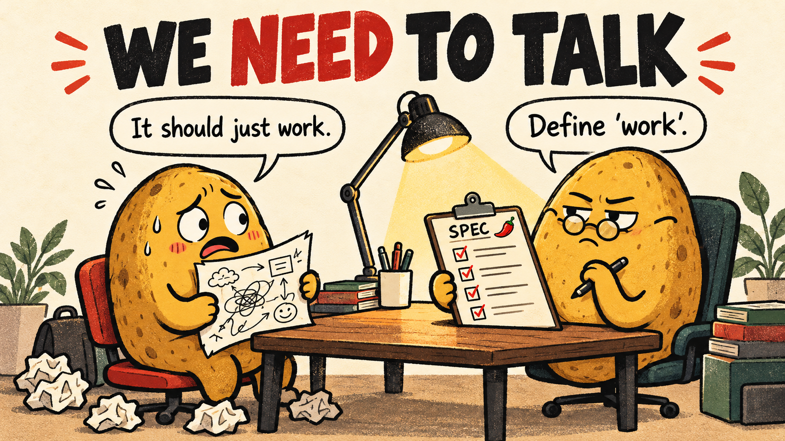
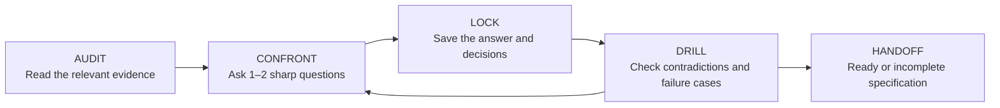

# We Need To Talk 🌶️

**Your spec said “it should just work.” We have follow-up questions.**

[English](README.md) · [한국어](README.ko.md)



[](https://github.com/Malko-opensource/we-need-to-talk/actions/workflows/validate.yml)
[](LICENSE)

**We Need To Talk** is an interview skill for **Codex and Claude Code**. It reads the relevant context, challenges vague requirements, and writes down decisions after every answer. The result is a specification you can hand to an implementation agent.

Inspired by the Korean phrase **“오빠 나랑 이야기 좀 해”** — the ominous “we need to talk” — but aimed at the holes in your spec. Your dignity survives. “Make it scalable” might not.

## A small taste

> **You:** “Don't store drafts anywhere. Also restore them after a crash.”
>
> **Skill:** “Those requirements conflict. Where would the restored draft come from?”
>
> **You:** “Okay, save them locally. No server sync.”
>
> **Skill:** *Records the decision.* “How much typing can be lost if the process dies before the next save?”

This is an illustrative conversation. The skill uses your actual files and answers as evidence.

## What you get

- **Questions with receipts.** Relevant code, docs, and earlier decisions ground the interview. No repository? It says so.
- **A record after every answer.** Decisions, assumptions, open issues, and sources stay in Markdown files.
- **Trade-offs with actual costs.** Options explain what you gain and give up, without invented estimates.
- **Changeable decisions.** Changed requirements supersede old decisions; history stays readable.
- **An honest handoff.** Unresolved blockers produce an `incomplete` spec, not a pretend agreement.
- **Pause and resume.** Continue from the saved files instead of relying on a long chat history.

No bundled server, API key, or additional service is required. You still need a working Codex or Claude Code setup with file access.

## Pick your heat

| Mode | Interview style | Typical exploration budget |
| --- | --- | --- |
| 🌱 `mild` | A calm senior asking about the biggest gaps | ~3–4 rounds |
| 🌶️ `spicy` | A lead who wants concrete costs and failure behavior | ~5–7 rounds |
| 🔥 `hell` | Every assumption meets a counterexample | ~8–12 rounds |

`spicy` is the default. These are guidelines, not quotas. Every mode asks only **1–2 questions at a time**. You can change your mind, defer a decision, lower the heat, or stop.

## Install

### Codex — standalone skill

With Git and Python 3.10 or later:

```sh
git clone https://github.com/Malko-opensource/we-need-to-talk.git
cd we-need-to-talk
python3 scripts/install.py codex
```

The installer copies the skill to `${CODEX_HOME:-~/.codex}/skills/we-need-to-talk` and refuses to overwrite a different installation. Start a new chat and invoke:

```text
$we-need-to-talk A notes app that restores drafts after a restart --spiciness spicy
```

If your Codex setup uses `~/.agents/skills`, choose that directory explicitly:

```sh
python3 scripts/install.py codex --skills-dir "$HOME/.agents/skills"
```

Use one installation location. [OpenAI's skill documentation](https://learn.chatgpt.com/docs/build-skills) describes current discovery paths; older/local builds can differ.

### Claude Code — plugin

In Claude Code, add the marketplace and install:

```text
/plugin marketplace add Malko-opensource/we-need-to-talk
/plugin install we-need-to-talk@we-need-to-talk
```

Then invoke:

```text
/we-need-to-talk:we-need-to-talk A notes app that restores drafts --spiciness spicy
```

For a local checkout, you can load the plugin directly:

```sh
claude --plugin-dir ./plugins/we-need-to-talk
```

Or install it as a standalone Claude skill with `python3 scripts/install.py claude` and invoke `/we-need-to-talk`. Choose either the plugin or the standalone skill to avoid duplicates.

### Codex — plugin alternative

The repository includes a Codex marketplace too:

```sh
codex plugin marketplace add Malko-opensource/we-need-to-talk
```

Install **We Need To Talk** from that marketplace in the app. See [OpenAI's plugin guide](https://developers.openai.com/plugins/build/plugins) for the installation flow supported by your version.

## Use it

### 1. Bring a topic

```text
$we-need-to-talk A local-first writing app. Challenge the requirements before we code.
```

The skill inspects the relevant project context, creates a session index, and asks about the most consequential missing decision. It follows your language; ask in Korean for a Korean interview and documents.

### 2. Make the trade-offs

```text
Keep drafts on this device. No accounts or cloud sync for v1.
```

The answer is saved before the next question. Ask for a recommendation when you need one. “You decide” is recorded as delegation, not misquoted as your direct choice.

### 3. Choose a folder or turn up the heat

```text
$we-need-to-talk Cancellation and timeout behavior --spiciness hell --output ./docs/specs/cancellation
```

| Input | Meaning |
| --- | --- |
| Topic | What to interview you about; existing conversation context can supply it |
| `--spiciness mild\|spicy\|hell` | Interview intensity; defaults to `spicy` |
| `--output <path>` | A new session directory |
| `--resume <path>` | Continue an existing session; retains its intensity unless overridden |

These are arguments interpreted by the skill inside your coding agent, not a separate terminal command.

### 4. Pause, resume, or finish

```text
Pause here. We'll decide the sync policy later.
```

```text
$we-need-to-talk --resume ./docs/specs/cancellation
```

```text
Write the final specification now and keep the unresolved items visible.
```

The output status tells you whether the spec is ready for implementation. A request for an interview does not itself authorize implementation or deployment.

## What lands on disk

```text
docs/specs/notes-app-2026-10-27/
├── _session-index.md       # Evidence, decisions, open issues, resume point
├── draft-storage.md        # Topic decisions and interview history
├── recovery-policy.md
├── _final-contract.md      # Consolidated implementation specification
└── _deferred-risks.md       # Created only when something is deferred
```

Without `--output`, sessions go under the project's `docs/specs/`, or `~/Documents/interviews/` when there is no project. Files appear as they become useful.

| ID / state | Meaning |
| --- | --- |
| `D-*` / `A-*` / `Q-*` | Decision / assumption / open issue |
| `E-*` / `R-*` | Evidence / interview round |
| `superseded` | A decision was replaced; its history remains |
| `ready` | The specification has the required decisions and acceptance criteria |
| `incomplete` | An implementation-blocking decision is still missing |
| `paused` | The user stopped the interview for now |
| `stale` | An existing final specification needs updating after a change |

`ready` describes the specification, not implemented or tested software. The skill gives the agent a workflow; it is not a separate engine that enforces every file write.

## Under the hood



The portable skill lives in [`plugins/we-need-to-talk/skills/we-need-to-talk`](plugins/we-need-to-talk/skills/we-need-to-talk). Both plugin manifests point to the same instructions and templates.

## Update, uninstall, and troubleshoot

- **Updating:** pull this repository and rerun the installer. An identical installation is left alone; a different one requires `--backup-existing`. Backups go under `.we-need-to-talk-backups/` beside the skill.
- **Not in the selector:** open a new chat, check the skill directory your agent scans, and avoid installing the same skill through multiple routes.
- **File writes unavailable:** the agent should report that and provide an unsaved draft, rather than claim persistence.
- **Uninstalling a standalone skill:** remove only its `we-need-to-talk` directory from the location printed by the installer. Your interview output stays in its own directory.

## Contribute

See [CONTRIBUTING.md](CONTRIBUTING.md) for local checks, packaging, and useful behavior reports. Translation improvements and realistic interview examples are welcome.

Format validation, packaging checks, and local skill discovery have been checked. Broad multi-round behavior across models remains an area for testing.

## Credits and license

Created by [Malko](https://github.com/Malko-opensource). The incremental interview idea was inspired by [`deep-interview`](https://github.com/aviz85/claude-skills-library/tree/90bbc16773886226be46375bec52a910dbfcf711/plugins/deep-interview). See [SOURCES.md](SOURCES.md) for attribution.

[MIT](LICENSE). The README illustration was generated with OpenAI's built-in image-generation tool; its prompt is in [docs/assets/PROVENANCE.md](docs/assets/PROVENANCE.md).
